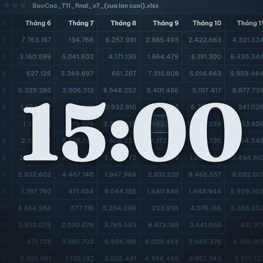

# wamotion

Material for an agent that writes Remotion videos itself: a sound bank, a tempo measurer, optional ears,
a 3D character kit and one review round. It is an [agent skill](https://agentskills.io): a folder with a
`SKILL.md` that Claude Code, Codex and other agents read on their own. The agent still writes a normal
Remotion project in whatever way it would alone; the skill contains no rule about how the film should look
or be built. In blind tests the same agent with this material beat the same agent without it on every item
scored, on two briefs (details and limits below).

## Three films, three prompts

Every film here was made by Claude Opus 5.5 (effort medium) in an empty folder with the prompt shown, in one
unattended run. The mp4s in [`examples/`](examples/) are muted and downscaled to keep the repository small.

| | |
|---|---|
|  | **15-second showreel** — [mp4](examples/showreel-15s.mp4) · [prompt](examples/showreel-15s.prompt.txt)<br>*"make a dynamic 15-second motion graphics video for Wamotion AI, shows what an incredible motion designer you are, like it's your showreel for a résumé. go all out."*<br>From the skill: six bank sounds placed by their attack time, the track measured at 132 BPM and cut to it, one `hear.sh` scorecard, one fresh-eyes review that caught a typo bug. The WebGL engine, motion blur and particles were the agent's own. The arm that won the first blind test. |
|  | **30-second Facebook ad for a tea shop** (1080×1080, Vietnamese on screen) — [mp4](examples/hem12-ad-30s.mp4) · [prompt](examples/hem12-ad-30s.prompt.txt)<br>A client-style brief: audience, goal, call to action, three must-haves, three things to avoid, three facts. From the skill: 22 bank sounds, tempo at 70 BPM, three ears calls that led the agent to add a mastering step, one review. The arm that won the second blind test. |
|  | **20-second ad with a 3D character in a real-lit scene** — [mp4](examples/hem12-3d-20s.mp4) · [prompt](examples/hem12-3d-20s.prompt.txt)<br>From the skill: the character kit (VRM, three body clips, PBR table, the frame-driven modules), 23 bank sounds, seven ears calls, one review. The agent recoloured the character's outfit, built hair and a skirt as geometry, and fetched extra Poly Haven props itself. Not blind-scored; shown as what the kit does. |

## The blind tests

Two tests, same method: the same prompt and model for every arm, films loudness-normalised and shuffled, the
author voting blind on five items (design, less AI slop, sound quality, sound-to-motion sync, overall).

| Date | Brief | Arms | Result |
|---|---|---|---|
| 2026-11-05 | 15 s showreel | agent + skill vs agent alone | skill won 5 of 5 |
| 2026-11-06 | 30 s tea-shop ad | agent + skill with ears vs agent + skill without ears vs agent alone | skill with ears won 5 of 5 against both |

One scorer who is also the author, one film per arm, not repeated: a signal that the material helps, not a
measurement of how much. Vote logs, keys, prompts and the original write-ups are in
[`docs/blind-tests/`](docs/blind-tests/README.md). Earlier tests of a desktop app around the same agent (guided
steps, review checklists, templates) never beat the agent alone with an identical prompt; removing those and
keeping only the material is what this repository is.

## Install

Needs git and Node ≥ 20. One line:

```bash
curl -fsSL https://raw.githubusercontent.com/hi-thanhn/wamotion/main/install.sh | sh
```

It clones only the skill folder (about 55 MB with the sound bank and the character kit) into
`~/.claude/skills/wamotion` and prints what landed. `--to <dir>` installs elsewhere, `--ref <tag>` picks a version.

Other ways:

```bash
npx skills add hi-thanhn/wamotion -g          # the skills CLI (skills.sh), any supported agent
git clone https://github.com/hi-thanhn/wamotion && ln -s "$(pwd)/wamotion/skills/wamotion" ~/.claude/skills/wamotion
```

Then open the agent in an empty folder and ask for the video the way you would ask a person. It finds the skill
by itself. Optional on top:

- **ffmpeg** on PATH, for `tempo.mjs` and the review's frame extraction (inside a Remotion project `npx remotion ffmpeg` also works).
- **Remotion's own skills**, `npx skills add remotion-dev/skills`: markup, timing, transitions, audio, fonts, 3D. Not bundled here because of their licence; they go well together.

## What the agent can call

Everything runs with plain `node` or `bash` from any folder, nothing to install, all offline except the ears.

| | |
|---|---|
| `scripts/sound.mjs search "<words>" [--kind whoosh\|impact\|riser\|sparkle\|transition\|foley\|ambience]` | 341 sound effects ranked by words, each with a description, `durationSec`, `peakLagSec` (time to the attack), roles. `--ears` ranks by listening instead. |
| `scripts/sound.mjs get <id or words> --to public/sfx` | copies the file in and prints its `staticFile` path |
| `scripts/sound.mjs music list [--mood …]` · `music get <id> --to public/music` | 14 CC0 tracks levelled near −16 LUFS, with mood, loop, LUFS, BPM |
| `scripts/sound.mjs credits <folder>` | finds every bank file a project uses, renamed copies too, and prints licences and a credits text |
| `scripts/tempo.mjs <track…>` | `{bpm, downbeatSec, meter, confidence}` for any track |
| `scripts/hear.sh <film.mp4>` and `hear.sh describe\|sheet\|timeline\|match\|rank\|find\|realness\|ab …` | the ears (optional, below): a soundtrack scorecard against seven professional launch films with timestamped fixes, what a sound is in words, a picture of cuts and sound events on one time axis, how well sounds fit a description |
| `references/review.md` | one review round: render real frames, hand them to a subagent that has not seen the code, answer each finding once |
| `cast/` + `references/character.md` | the character kit, below |
| `references/motion-prompt/`, `references/sound-design/`, `references/vector-art/` | named motion moves (MIT), what professional launch films measurably do with sound (MIT), drawing SVG in layers |

[`skills/wamotion/SKILL.md`](skills/wamotion/SKILL.md) is the ~750 words the agent reads.

## Ears (optional)

The ears are [earshot](https://github.com/Leonxlnx/earshot) by Leon Lin (MIT): models that score, describe and
compare sound. Without them every `hear.sh` call prints one line and exits; the skill works. Two ways to have them:

- **Locally**: a Python 3.12 venv with earshot at the pinned commit, about 4 GB with CPU torch and the models.
  `hear.sh` prints the exact install command when it finds nothing. Each call loads the models again (about 4–5 s).
- **Self-hosted server**: [`ears/`](ears/README.md) is a FastAPI wrapper that keeps earshot warm in Docker, on
  your own machine or a box of yours. Set `WAMOTION_EARS_URL` and `WAMOTION_EARS_TOKEN`; `hear.sh` sends the
  command and its files there and prints exactly what a local install would. There is no hosted service; it is
  yours to run.

## Character kit

[`skills/wamotion/cast/`](skills/wamotion/cast/): a CC0 VRoid VRM that walks, talks with mouth shapes from a voice
line, looks at the camera and blinks; eleven CC0 Quaternius body clips retargeted to it, and a script for the
other 35; `lipsync.sh` (macOS `say` + Rhubarb); three CC0 Poly Haven HDRIs and four CC0 PBR texture sets; and
small TypeScript modules (`CastCanvas`, `Hdri`, `Character`, `Post` with depth of field and seeded grain, loaders)
that render it all from the Remotion frame, deterministically. A Remotion project that uses it needs:

```bash
npm i three@0.180.0 @pixiv/three-vrm@3.5.5 @react-three/fiber@9.8.2 @remotion/three@<your remotion version> postprocessing@6.39.6 @react-three/drei@10.7.9
npm i -D @types/three@0.180.0
npx remotion render … --gl=angle        # WebGL renders blank without it; --gl=swangle on a box with no GPU
```

[`references/character.md`](skills/wamotion/references/character.md) says what each piece is, what it costs to
render, how to add a clip or another VRM, and what it cannot do (the character is a toon shader next to a PBR set;
Vietnamese mouth shapes are acoustic guesses).

## Licences

Code is MIT ([LICENSE](LICENSE)). The bundled material has its own licences, each next to the asset; the
summary is in [LICENSES.md](LICENSES.md).

| Material | Licence | From |
|---|---|---|
| 89 recordings + 14 music tracks | CC0 | Kenney, Freesound, OpenGameArt |
| 252 `es-…` effects | MIT | earshot bank recipes |
| VRM character | CC0 | VRoid Studio base model |
| 11 body clips | CC0 | Quaternius |
| HDRIs, PBR textures | CC0 | Poly Haven |
| Rhubarb Lip Sync (downloaded on use) | MIT | Daniel Wolf |
| motion-prompt | MIT | Shohei Ohtaki |
| earshot (installed on use) | MIT | Leon Lin |

CC0 and MIT ask for no attribution in a finished video; `sound.mjs credits` prints one anyway for those who want it.

## Credits

Leon Lin for earshot and its sound recipes; Shohei Ohtaki for motion-prompt; Kenney, the Freesound and
OpenGameArt contributors named in `bank/ATTRIBUTION.md`; the VRoid Project; Quaternius; Poly Haven; Daniel Wolf
for Rhubarb; the Remotion team. The scripts began as parts of a desktop app that the blind tests retired.
