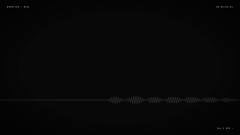
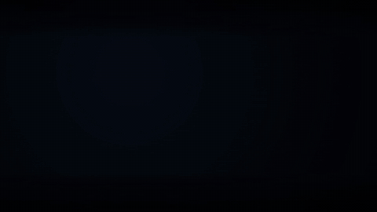
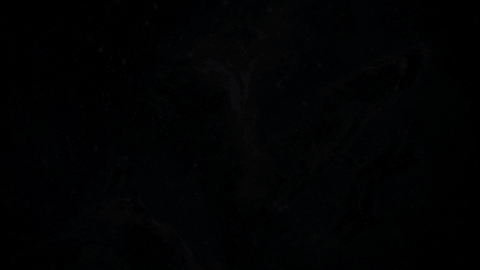
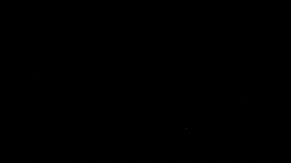
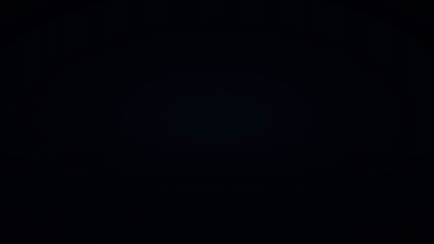

# wamotion

Material for an agent that writes Remotion videos itself: a sound bank, a tempo measurer, optional ears,
a 3D character kit and one review round. It is an [agent skill](https://agentskills.io): a folder with a
`SKILL.md` that Claude Code, Codex and other agents read on their own. The agent still writes a normal
Remotion project in whatever way it would alone; the skill contains no rule about how the film should look
or be built. In blind tests the same agent with this material beat the same agent without it on every item
scored, on two briefs (details and limits below).

## Films and prompts

Every film here was made by Claude Opus 5.5 in an empty folder with the prompt shown, in one unattended run, with
the ears available over a local server (the reel at effort medium, the data films at effort high). The data films
are built from real public-domain or CC BY material the brief points at; each has a `.SOURCE.md` next to it. The mp4s in [`examples/`](examples/) are muted and
downscaled to keep the repository small; films whose sound fits under 10 MB also have an `.audio.mp4`. "From the
skill" lists what the agent actually called, read from its transcript, not from what it said it did. Cost and
minutes are the agent's own, from the `claude -p` result line.

| | |
|---|---|
|  | **19-second reel for Wamotion itself** — [mp4](examples/wamotion-reel-19s.mp4) · [with sound](examples/wamotion-reel-19s.audio.mp4) · [prompt](examples/wamotion-reel-19s.prompt.txt)<br>The brief gives one paragraph of facts, the mood, and "sound must be the best part"; the look is the agent's. Every number on screen is measured on this film: the 341 waveforms are the bank, the BPM counter lands on the measured 146.3, the scorecard shot shows the ears' real result. From the skill: 18 bank sounds and the bank track *The Rush*, `tempo.mjs` once, eleven ears calls (`timeline` on the track as JSON for the beat grid, the scorecard after each render), the character kit (the VRM recoloured as clay, the dance clip, the `Post` module, an HDRI and the concrete PBR set for the floor), `credits`, and one fresh-eyes review that found placeholder captions in the review shot and had them replaced with its own findings. The extruded 3D logo is the agent's. Final scorecard 23 of 23. $5.16 · 21 min. |
|  | **18 seconds of thirty days of real earthquakes** — [mp4](examples/quakes-18s.mp4) · [with sound](examples/quakes-18s.audio.mp4) · [prompt](examples/quakes-18s.prompt.txt) · [source](examples/quakes-18s.SOURCE.md)<br>665 USGS events of magnitude 4.5 and up, 2026-10-10 to 2026-11-09, each striking at its true place in true order on NASA's night map; time slows for the magnitude 7.0 near Nagqu and its aftershocks are listed as they arrive. From the skill: one bank sound, two `describe` calls while choosing sounds, the scorecard three times and one `sheet`, `credits`, and one fresh-eyes review. The kalimba note per quake, pitched by magnitude and depth, is the agent's own synthesis. Final scorecard 17 of 22 (the mix sits at −16.2 LUFS). $5.72 · 23 min. |
|  | **18-second flight through three real Webb images** — [mp4](examples/deep-field-18s.mp4) · [with sound](examples/deep-field-18s.audio.mp4) · [prompt](examples/deep-field-18s.prompt.txt) · [source](examples/deep-field-18s.SOURCE.md)<br>Pillars of Creation, the Cosmic Cliffs and Webb's First Deep Field (ESA/Webb, CC BY 4.0), each split into depth layers from its own pixels and flown through with a real 3D camera, no cut between objects; names, distances and the credits on screen. The agent noticed that one file in the brief's data folder was mislabelled (it was the Southern Ring Nebula), fetched the right image itself and wrote the swap down. From the skill: two sound searches, two bank recordings under its own slow instrument, one `describe`, three `realness` checks. No review round. Final scorecard 16 of 22 (quiet, no hits; an ambient piece by design). $6.95 · 36 min. |
|  | **18-second Earth at night, one revolution and a sunrise** — [mp4](examples/night-earth-18s.mp4) · [with sound](examples/night-earth-18s.audio.mp4) · [prompt](examples/night-earth-18s.prompt.txt) · [source](examples/night-earth-18s.SOURCE.md)<br>A three.js globe with a real night-lights texture (NASA Earth at Night data via Solar System Scope, CC BY 4.0), three of the twenty most populous cities named with Wikidata populations as they pass, the sun breaking the limb once, credits at the end. From the skill: the bank track *Vaporware* and five bank sounds, `timeline` with cue times on the mix, one scorecard, `credits`, and one fresh-eyes review that fixed label legibility and a bloom artefact. Final scorecard 18 of 22; the ears read the agent's own drone as synthetic (realness 0.44). $7.41 · 43 min. |
|  | **18 seconds of six years of real commits** — [mp4](examples/ten-thousand-commits-18s.mp4) · [with sound](examples/ten-thousand-commits-18s.audio.mp4) · [prompt](examples/ten-thousand-commits-18s.prompt.txt) · [source](examples/ten-thousand-commits-18s.SOURCE.md)<br>The 40,870 commits of the Remotion repository, 2020 to 2026, in true order: directories grow as branches, files appear the first time they are touched, every commit is a flash and a glass-bell grain, busy weeks become a storm, the four major releases send a wave through the whole tree; the only text is the year and the two real counts. From the skill: seven bank recordings (rain, room tone, bells, a sub drop, a down-lifter, a soft whoosh, a low impact) read straight from the bank folder into the agent's own offline score, the scorecard twice, and one fresh-eyes review that fixed small counts, a camera jump and colour drift. Final scorecard 21 of 22 (the one miss asks for a continuous music track; this piece has none by design). $7.53 · 36 min. |

## The blind tests

Two tests, same method: the same prompt and model for every arm, films loudness-normalised and shuffled, the
author voting blind on five items (design, less AI slop, sound quality, sound-to-motion sync, overall).

| Date | Brief | Arms | Result |
|---|---|---|---|
| 2026-11-05 | 15 s showreel | agent + skill vs agent alone | skill won 5 of 5 |
| 2026-11-06 | 30 s ad brief with real must-haves | agent + skill with ears vs agent + skill without ears vs agent alone | skill with ears won 5 of 5 against both |

One scorer who is also the author, one film per arm, not repeated: a signal that the material helps, not a
measurement of how much. Vote logs, keys, prompts and the original write-ups are in
[`docs/blind-tests/`](docs/blind-tests/README.md). Earlier tests of a desktop app around the same agent (guided
steps, review checklists, templates) never beat the agent alone with an identical prompt; removing those and
keeping only the material is what this repository is.

## Install

Needs git and Node ≥ 20. One line:

```bash
curl -fsSL https://raw.githubusercontent.com/hi-thanhn/wamotion/main/install.sh | sh
```

It clones only the skill folder (about 55 MB with the sound bank and the character kit) into
`~/.claude/skills/wamotion` and prints what landed. `--to <dir>` installs elsewhere, `--ref <tag>` picks a version.

Other ways:

```bash
npx skills add hi-thanhn/wamotion -g          # the skills CLI (skills.sh), any supported agent
git clone https://github.com/hi-thanhn/wamotion && ln -s "$(pwd)/wamotion/skills/wamotion" ~/.claude/skills/wamotion
```

Then open the agent in an empty folder and ask for the video the way you would ask a person. It finds the skill
by itself. Optional on top:

- **ffmpeg** on PATH, for `tempo.mjs` and the review's frame extraction (inside a Remotion project `npx remotion ffmpeg` also works).
- **Remotion's own skills**, `npx skills add remotion-dev/skills`: markup, timing, transitions, audio, fonts, 3D. Not bundled here because of their licence; they go well together.

## What the agent can call

Everything runs with plain `node` or `bash` from any folder, nothing to install, all offline except the ears.

| | |
|---|---|
| `scripts/sound.mjs search "<words>" [--kind whoosh\|impact\|riser\|sparkle\|transition\|foley\|ambience]` | 341 sound effects ranked by words, each with a description, `durationSec`, `peakLagSec` (time to the attack), roles. `--ears` ranks by listening instead. |
| `scripts/sound.mjs get <id or words> --to public/sfx` | copies the file in and prints its `staticFile` path |
| `scripts/sound.mjs music list [--mood …]` · `music get <id> --to public/music` | 14 CC0 tracks levelled near −16 LUFS, with mood, loop, LUFS, BPM |
| `scripts/sound.mjs credits <folder>` | finds every bank file a project uses, renamed copies too, and prints licences and a credits text |
| `scripts/tempo.mjs <track…>` | `{bpm, downbeatSec, meter, confidence}` for any track |
| `scripts/hear.sh <film.mp4>` and `hear.sh describe\|sheet\|timeline\|match\|rank\|find\|realness\|ab …` | the ears (optional, below): a soundtrack scorecard against seven professional launch films with timestamped fixes, what a sound is in words, a picture of cuts and sound events on one time axis, how well sounds fit a description |
| `references/review.md` | one review round: render real frames, hand them to a subagent that has not seen the code, answer each finding once |
| `cast/` + `references/character.md` | the character kit, below |
| `references/motion-prompt/`, `references/sound-design/`, `references/vector-art/` | named motion moves (MIT), what professional launch films measurably do with sound (MIT), drawing SVG in layers |

[`skills/wamotion/SKILL.md`](skills/wamotion/SKILL.md) is the ~750 words the agent reads.

## Ears (optional)

The ears are [earshot](https://github.com/Leonxlnx/earshot) by Leon Lin (MIT): models that score, describe and
compare sound. Without them every `hear.sh` call prints one line and exits; the skill works. Two ways to have them:

- **Locally**: a Python 3.12 venv with earshot at the pinned commit, about 4 GB with CPU torch and the models.
  `hear.sh` prints the exact install command when it finds nothing. Each call loads the models again (about 4–5 s).
- **Self-hosted server**: [`ears/`](ears/README.md) is a FastAPI wrapper that keeps earshot warm in Docker, on
  your own machine or a box of yours. Set `WAMOTION_EARS_URL` and `WAMOTION_EARS_TOKEN`; `hear.sh` sends the
  command and its files there and prints exactly what a local install would. There is no hosted service; it is
  yours to run.

## Character kit

[`skills/wamotion/cast/`](skills/wamotion/cast/): a CC0 VRoid VRM that walks, talks with mouth shapes from a voice
line, looks at the camera and blinks; eleven CC0 Quaternius body clips retargeted to it, and a script for the
other 35; `lipsync.sh` (macOS `say` + Rhubarb); three CC0 Poly Haven HDRIs and four CC0 PBR texture sets; and
small TypeScript modules (`CastCanvas`, `Hdri`, `Character`, `Post` with depth of field and seeded grain, loaders)
that render it all from the Remotion frame, deterministically. A Remotion project that uses it needs:

```bash
npm i three@0.180.0 @pixiv/three-vrm@3.5.5 @react-three/fiber@9.8.2 @remotion/three@<your remotion version> postprocessing@6.39.6 @react-three/drei@10.7.9
npm i -D @types/three@0.180.0
npx remotion render … --gl=angle        # WebGL renders blank without it; --gl=swangle on a box with no GPU
```

[`references/character.md`](skills/wamotion/references/character.md) says what each piece is, what it costs to
render, how to add a clip or another VRM, and what it cannot do (the character is a toon shader next to a PBR set;
Vietnamese mouth shapes are acoustic guesses).

## Licences

Code is MIT ([LICENSE](LICENSE)). The bundled material has its own licences, each next to the asset; the
summary is in [LICENSES.md](LICENSES.md).

| Material | Licence | From |
|---|---|---|
| 89 recordings + 14 music tracks | CC0 | Kenney, Freesound, OpenGameArt |
| 252 `es-…` effects | MIT | earshot bank recipes |
| VRM character | CC0 | VRoid Studio base model |
| 11 body clips | CC0 | Quaternius |
| HDRIs, PBR textures | CC0 | Poly Haven |
| Rhubarb Lip Sync (downloaded on use) | MIT | Daniel Wolf |
| motion-prompt | MIT | Shohei Ohtaki |
| earshot (installed on use) | MIT | Leon Lin |

CC0 and MIT ask for no attribution in a finished video; `sound.mjs credits` prints one anyway for those who want it.

## Credits

Leon Lin for earshot and its sound recipes; Shohei Ohtaki for motion-prompt; Kenney, the Freesound and
OpenGameArt contributors named in `bank/ATTRIBUTION.md`; the VRoid Project; Quaternius; Poly Haven; Daniel Wolf
for Rhubarb; the Remotion team. The scripts began as parts of a desktop app that the blind tests retired.
